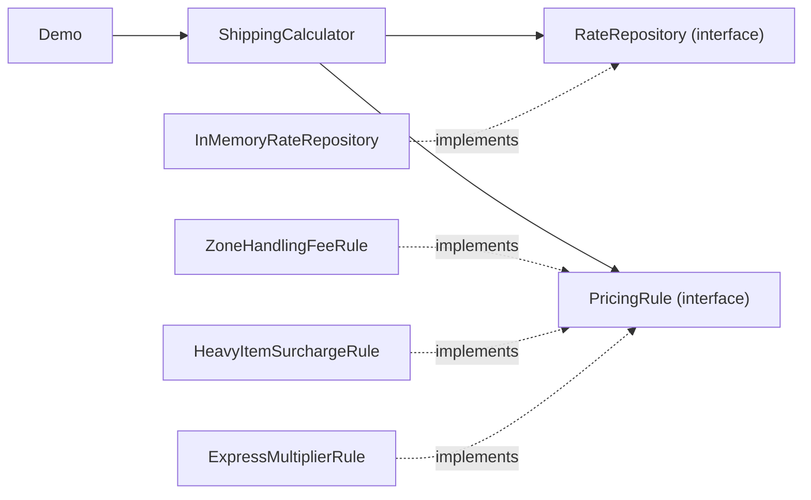

# Tidewater Freight : Shipping Cost Service
### This is the starter repository for the **Code Quality & Testing** applied lab.


## How is works
A small Java service that calculates shipping costs (in GHS) for a shipment based
on its destination zone, weight and service level. The code base initially generated by AI has now been refactored to follow SOLID
principles, reduce code smell,  handle failures explicitly and be covered by a test suite.

## How costs are calculated

1. **Base cost** = zone rate per kg × weight in kg
2. **Zone handling fee** is added for some zones
3. **Heavy-item surcharge** is added when the weight is *over* 30 kg
4. **Express multiplier** (×1.5) is applied last, so it also multiplies the fees and surcharge

| Zone | Rate per kg (GHS) | Handling fee (GHS) |
|---|---|---|
| `DOMESTIC` | 5.00 | none |
| `REGIONAL` | 8.00 | 10 |
| `INTERNATIONAL` | 15.00 | 25 |

| Rule | Value |
|---|---|
| Heavy-item surcharge | +20 when weight is **over** 30 kg (exactly 30 kg has no surcharge) |
| `EXPRESS` service | ×1.5 on the running total |
| `STANDARD` service | no change |

**Worked examples**

| Shipment | Calculation | Cost |
|---|---|---|
| Domestic, 10 kg, standard | 10 × 5 | **50** |
| Regional, 31 kg, standard | 31 × 8 = 248, + 10 fee, + 20 surcharge | **278** |
| International, 40 kg, express | (40 × 15 = 600, + 25 fee, + 20 surcharge) × 1.5 | **967.5** |

## Project structure

```
tidewater-freight/
├── pom.xml
└── src/
    ├── main/java/com/tidewater/freight/
    │   ├── Demo.java                        entry point
    │   ├── domain/
    │   │   ├── Zone.java                    enum: DOMESTIC, REGIONAL, INTERNATIONAL
    │   │   ├── ServiceLevel.java            enum: STANDARD, EXPRESS
    │   │   └── ShipmentRequest.java         validated, immutable input (record)
    │   ├── pricing/
    │   │   ├── ShippingCalculator.java      applies the rules in order
    │   │   ├── PricingRule.java             interface: one pricing step
    │   │   └── rules/
    │   │       ├── ZoneHandlingFeeRule.java
    │   │       ├── HeavyItemSurchargeRule.java
    │   │       └── ExpressMultiplierRule.java
    │   └── rate/
    │       ├── RateRepository.java          interface: where rates come from
    │       ├── InMemoryRateRepository.java
    │       └── RateNotFoundException.java
    └── test/java/com/tidewater/freight/     mirrors the main structure
```

## Design



## Running it

You need JDK 21 or higher and Maven.

**See the service run (a small demo, no tests):**

```bash
mvn compile
mvn exec:java -Dexec.mainClass=com.tidewater.freight.Demo
```

Note that `BigDecimal` keeps its decimal places, so the international example prints as `967.500`. Format to two places at the display edge with `setScale(2, RoundingMode.HALF_UP)` when showing money to users.

**Run the tests:**

```bash
mvn test
```

**Measure your tests** (coverage and mutation testing are already set up):

```bash
mvn verify                                                  # tests + JaCoCo report: target/site/jacoco/index.html
mvn test-compile org.pitest:pitest-maven:mutationCoverage   # PIT report: target/pit-reports/index.html
```

## Testing coverage

| Layer | What it tests | Tools |
|---|---|---|
| **Rule tests** | Each `PricingRule` alone, including boundaries (29.99, 30 and 30.01 kg) | JUnit 5 parameterized tests |
| **Repository tests** | Default rates, and the missing-rate error path | JUnit 5 |
| **Domain tests** | `ShipmentRequest` accepts valid input and rejects bad input | JUnit 5 |
| **Calculator unit tests** | `ShippingCalculator` in isolation, with mocked repository and rules | Mockito |
| **End-to-end tests** | Real classes wired together, checked against the worked examples above | JUnit 5 |


## Adding a new pricing rule

1. Create a class in `pricing/rules/` that implements `PricingRule`.
2. Add a test class for it, including boundary cases.
3. Add an instance to the rule list in `Demo` (mind the order).
``NOTE: No existing class needs editing.``


**See the service run (a small demo, no tests):**

```bash
mvn compile
mvn exec:java -Dexec.mainClass=com.tidewater.freight.Demo
```

**Run the existing tests:**

```bash
mvn test
```

**Measure your tests** (coverage and mutation testing are already set up):

```bash
mvn verify                                                  # tests + JaCoCo report: target/site/jacoco/index.html
mvn test-compile org.pitest:pitest-maven:mutationCoverage   # PIT report: target/pit-reports/index.html
```

Run the demo and the tests before you change anything. Note what the demo prints for an unknown zone,
and look carefully at whether the tests that pass actually prove anything.

## Contributions
This project is part of a course assessment work, contribution isn't allowed. By for leanring purposes you can fork into your own repo and make your own updates to the code.

#### By [etornam-ahiataku](https://github.com/etornam-ahiataku/code-quality-b-tidewater-freight)
Contact: [etornam-ahiataku](mailto:etornam-ahiataku@amalitech.com)
